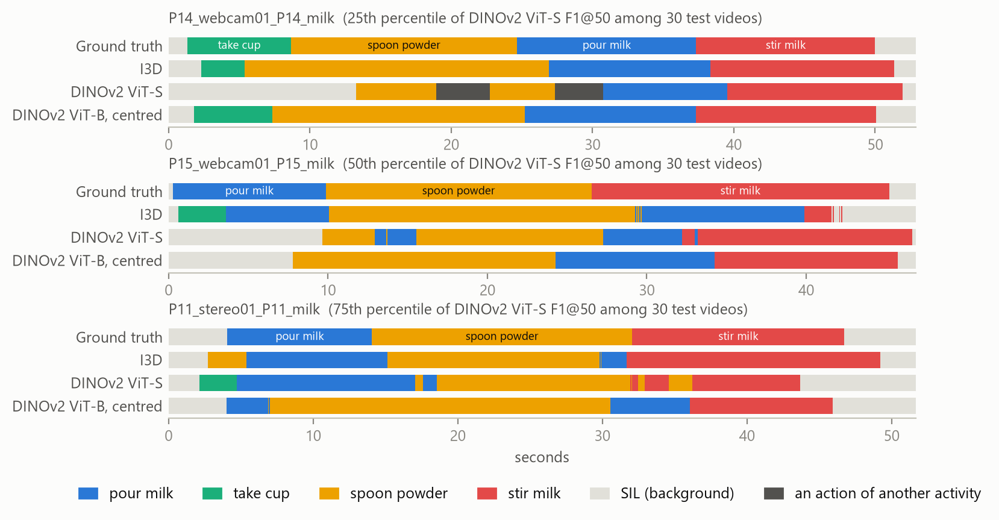

# action-segmentation

Temporal action segmentation labels every frame of a video with the action under way. MS-TCN
(Abu Farha and Gall, CVPR 2019) does it from I3D features, which come from a video network
that also takes optical flow. This repo keeps MS-TCN as published and gives it frozen DINOv2
features of single frames instead, on Breakfast: 1,692 videos of 52 people making ten
breakfasts, 48 action classes, four splits by person.

*Three of split 1's 30 test videos of making milk, at the 25th, 50th and 75th percentile of
ViT-S's F1@50. Dark grey is an action from another breakfast.*

## Results

Each row: four splits by three seeds, mean ± standard deviation over the seeds.

| features | F1@10 | F1@25 | F1@50 | Edit | Acc |
|---|---|---|---|---|---|
| I3D, the paper (1,712 videos) | 52.6 | 48.1 | 37.9 | 61.7 | 66.3 |
| I3D | 51.8 ± 2.0 | 47.1 ± 1.9 | 37.2 ± 1.6 | 60.0 ± 1.4 | 64.6 ± 1.1 |
| I3D, centred | 52.7 ± 1.5 | 48.2 ± 1.5 | 38.4 ± 0.9 | 59.6 ± 1.6 | 65.7 ± 2.4 |
| DINOv2 ViT-S/14 | 36.5 ± 1.2 | 31.1 ± 1.2 | 21.3 ± 1.0 | 45.9 ± 1.5 | 41.7 ± 1.6 |
| ViT-S/14 with motion | 37.1 ± 1.6 | 31.8 ± 1.3 | 21.7 ± 1.0 | 46.7 ± 1.2 | 41.7 ± 0.4 |
| ViT-S/14, centred | 45.3 ± 0.5 | 39.7 ± 0.7 | 29.1 ± 0.9 | 52.9 ± 1.1 | 50.2 ± 1.1 |
| DINOv2 ViT-B/14 | 42.3 ± 0.3 | 37.1 ± 0.6 | 26.9 ± 0.6 | 52.5 ± 1.0 | 49.3 ± 0.9 |
| ViT-B/14, centred | 48.0 ± 2.3 | 42.7 ± 2.1 | 32.0 ± 1.6 | 54.8 ± 1.5 | 55.4 ± 1.4 |

I3D in this code lands within 2 points of the paper on every metric. Frozen DINOv2
ViT-S is 16 points of F1@50 behind it, and gives a third of the test frames an action from
another breakfast, against 14% for I3D.

The motion cue, each frame's features next to their difference from 4 frames earlier, adds
half a point. DINOv2's loss against I3D per action does not follow how much the action changes
the pixels (Spearman ρ = −0.04, [figure](docs/figures/per_action.png)). ViT-B/14 adds 5.6
points over ViT-S.

The largest change came from centring, subtracting each video's mean feature. Three quarters
of the ViT-S features' variance lies between videos, in what stays fixed within one (kitchen,
camera, person); for I3D, a third. Centring adds 7.8 points to ViT-S, 5.1 to ViT-B and 1.2 to
I3D, so centred ViT-B ends 6.4 points behind centred I3D. I added it after the validation
runs, where ViT-S got 88% of training frames right but 32% of held-out ones.

## How it was run

MS-TCN is the official code, ported to Python 3 and checked on GTEA.
[docs/method.md](docs/method.md) has the details; every run is in [runs/breakfast](runs/breakfast).

## Running it

    uv pip install -r requirements.txt    # see its first lines for the torch index
    python -I scripts/download_data.py data
    python -I scripts/extract_dinov2.py data vits14
    python -I scripts/train_grouped.py --data data/ms-tcn/data --exclude checks/excluded.txt --setting dinov2-vits14=data/features/dinov2-vits14

Frozen DINOv2 has been compared with I3D before: Bahrami et al. (2025) on EgoExoLearn across
unseen camera views, and TWLV-I (2024) among video and image models on Breakfast.

MIT for the code; the MS-TCN port keeps its own licence
([mstcn/LICENSE-ms-tcn](mstcn/LICENSE-ms-tcn)). Breakfast's videos and features are not
redistributed here.
